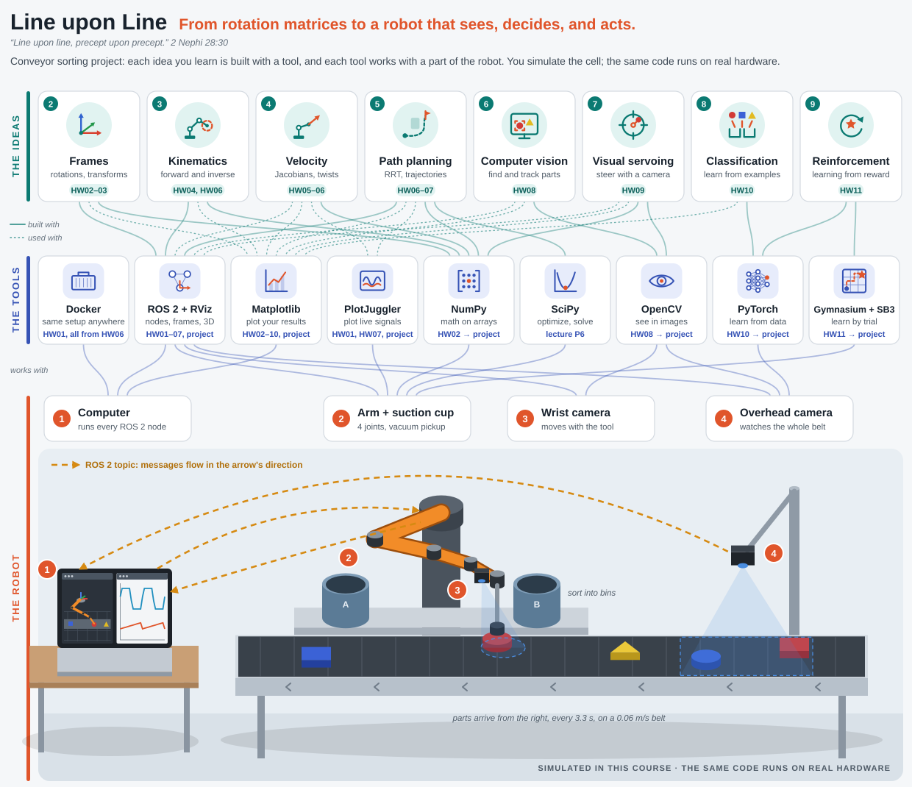

# Introduction to Robotics

Start with **[the setup guide](docs/setup.md)**, then
complete **[HW01: a ROS 2 joint-state publisher](homework/hw01/README.md)**
using the assignment handout supplied by your instructor.

Continue with [the cumulative Python workflow](STUDENT_GUIDE.md) and the
provided activity guides for [HW02](homework/hw02/README.md),
[HW03](homework/hw03/README.md), [HW04](homework/hw04/README.md),
[HW05](homework/hw05/README.md), [HW06](homework/hw06/README.md),
[HW07](homework/hw07/README.md), [HW08](homework/hw08/README.md),
[HW09](homework/hw09/README.md), [HW10](homework/hw10/README.md), and
[HW11](homework/hw11/README.md), then [the conveyor sorting
project](homework/project/README.md). Complete assignments in order; later methods
intentionally remain labeled stubs until you implement them. HW02--HW05 run
Python on your own computer; their ROS problems and later work run in the
container. See [two places to run commands](docs/setup.md#two-places-to-run-commands).
After setup, the [quick start](docs/quick_start.md) lists the commands for
every session, and [troubleshooting](docs/troubleshooting.md) collects fixes.

## Where the course is headed

Each idea you learn is built with a tool, and each tool works with a part of
the robot in the final conveyor project. For the clickable version, open
`docs/figures/robot_stack.html` in your browser from your copy of this
repository (double-click it in your file browser), then click any idea,
tool, or part to see where you learn it and how real robots use it.

This repository uses ROS 2 Jazzy on Ubuntu 24.04 inside Docker, with a
Linux desktop you view in your web browser. The [setup guide](docs/setup.md)
explains every step.

Use `student_ws/python/` for later standalone Python work and
`student_ws/ros2_ws/src/` for ROS packages. HW01 starts with one standalone
ROS-aware Python script to keep the first exercise small.

Follow [the AI tutoring policy](AI_TUTORING_GUIDE.md), keep your code readable,
and disclose AI use as requested. This release covers HW01--HW11 and the
conveyor sorting project.
