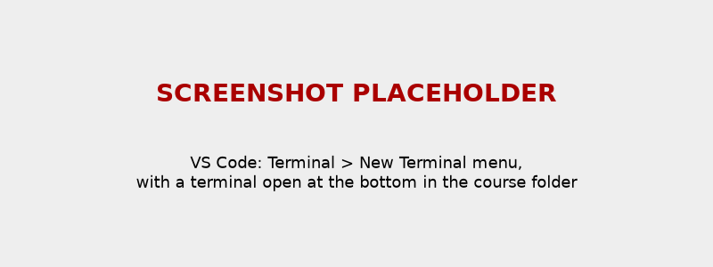
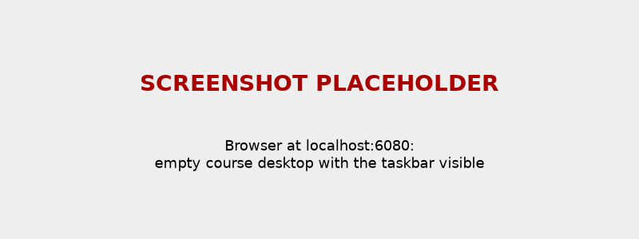
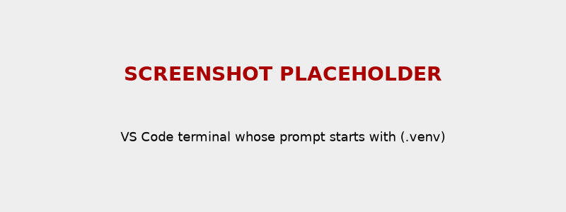

# Set up the course environment

Complete **all** of this guide during the first week, before HW01 is due, even
the parts labeled for later homework. Finding a problem now is much easier
than finding it the night before HW02 or HW06 is due. HW01 problem 1 asks
for evidence from several steps below.

After setup, the [quick start](quick_start.md) lists the few commands you use
every session, and [troubleshooting](troubleshooting.md) collects fixes for
common problems. Tip: in VS Code, press Ctrl+Shift+V (Cmd+Shift+V on macOS)
in a `.md` file to read it formatted.

What you will set up:

| Part | What it gives you | First used |
| --- | --- | --- |
| [1](#part-1-docker-ros-2-and-the-browser-desktop) | Docker, ROS 2, and a Linux desktop in your browser | HW01 |
| [2](#python-on-your-own-computer-hw02--hw05) | Python and a 3D viewer on your own computer | HW02 |
| [3](#python-in-the-container-hw06-onward) | OpenCV and the other container Python libraries | HW06 |

## Part 1: Docker, ROS 2, and the browser desktop

### Install Docker

Docker runs a small Linux computer (a *container*) inside your own computer,
with ROS 2 and every course library already installed. Everyone gets the same
environment, whatever operating system they use.

- **Windows:** follow [Windows setup](windows.md), then come back here.
- **Mac (Apple Silicon or Intel):** follow [Mac setup](macos.md), then come back here.
- **Linux:** install Docker Engine and its Compose plugin using
  [Docker's installation guide](https://docs.docker.com/engine/install/).

### Open the course folder and a terminal in VS Code

You need a copy of the course repository on your computer. Open that folder
in VS Code (**File > Open Folder...**). We strongly recommend VS Code, but any
editor works.

Most commands in this course are typed into a **terminal**, a window where you
type commands instead of clicking. VS Code has one built in: type Ctrl+Shift+P and then start typing the following **Terminal > New Terminal** and select it from the menu when it shows up. Or, you press Ctrl+\` (Control and the
backtick key, left of 1; this is Control on macOS too). The terminal opens at the bottom of the window, already in the course folder (the one
containing `compose.yaml`). On Windows it is PowerShell; on macOS it is zsh;
on Linux it is usually bash. The **+** button in the terminal panel opens
another one, which you will need when two programs run at once.



### Check that Docker is running

Start the Docker Desktop application (Windows and macOS) and wait until it
says the engine is running. Then, in the VS Code terminal:

```text
docker version
docker compose version
```

Docker has two halves: the **client** is the `docker` command you type, and
the **server** (the *engine*) is the part that actually runs containers. When
the engine is running, the output has both a `Client:` and a `Server:`
section, looking something like this:

```text
Client:
 Version:           29.9.3
 ...
 OS/Arch:           windows/amd64

Server: Docker Desktop 4.99.0 (245822)
 Engine:
  Version:          29.9.3
  ...
  OS/Arch:          linux/amd64
```

Your version numbers may differ; that is fine. If you see only the `Client:`
section followed by an error such as `failed to connect to the docker API` or
`Cannot connect to the Docker daemon`, the engine is not running: start
Docker Desktop, wait for it to finish starting, and try again.
`docker compose version` should print a line such as
`Docker Compose version v5.7.0`.

### Build and start the container

In the VS Code terminal, in the course folder:

```text
docker compose build
docker compose up -d
```

What these do:

- `docker compose build` creates the course **image**: a saved snapshot of a
  Linux system with ROS 2 and the course libraries installed, built from the
  recipe in `docker/Dockerfile`. The first build downloads a few gigabytes
  and can take 5--20 minutes (but usually much less). You only need to build again when the instructor
  announces a change to that recipe.
- `docker compose up -d` starts a **container**, which is a running copy of that
  Linux image or virtual computer. `-d` runs it in the background, so your terminal is free again for typing additional commands.

The container **mounts** the course folder, which means that your folder on your computer
appears inside the Linux container as `/workspace`. It is one set of the same files seen from
two places, not a copy. A file you save in VS Code is immediately the file the
container uses, and anything the container writes into `/workspace` appears in
your folder. That is why your work is safe when the container stops, since it was
always stored on your own computer.

### Open the browser desktop

Programs with graphics or windows, such as RViz (the ROS 3D viewer), run inside the
container on a Linux desktop that you view in your web browser. Open your
usual browser on this same computer and visit:

**<http://localhost:6080/vnc.html?autoconnect=1&resize=scale>**

Bookmark this address. Docker Desktop's own dashboard does not show this
graphical desktop. After loading that page, you should see an empty desktop with a taskbar along the bottom.
Nothing else runs yet, but you will start programs yourself in the next steps.
Each window you open appears on the taskbar; click its name there to bring a
hidden or minimized window back to the front.



If the page does not load, see
[troubleshooting](troubleshooting.md#the-browser-page-does-not-load-or-stays-blank).

### Two places to run commands

In this class, you type commands in one of two places:

| | Host terminal | Container shell |
| --- | --- | --- |
| What it is | A terminal on your own computer (the VS Code terminal), in the course folder | A Linux terminal *inside* the container, opened from a host terminal with `docker compose exec course bash` |
| Prompt starts with | `PS C:\...>` on Windows, or `you@laptop ...` on macOS/Linux; `(.venv)` is added once you activate Python ([Part 2](#python-on-your-own-computer-hw02--hw05)) | `student@` and ends with `:/workspace$` |
| Use it for | `docker compose` commands; HW02--HW05 Python activities, viewers, and public checks | Anything with ROS (`ros2`, `colcon`, launch files, TF, URDF, RViz): HW01, HW03 problem 4, HW04 problem 5; and all work from HW06 on |
| Windows open on | Your own desktop | The browser desktop |

**Rule of thumb:** if a step mentions ROS, TF, URDF, or RViz, or starts with
`ros2` or `colcon`, use the container shell. Otherwise, during HW02--HW05, use
a host terminal. From HW06 on, use the container shell.

Think of the container shell as logging in to the small Linux computer that
`docker compose up -d` started. To open one, type this in a host terminal
(the container must already be running):

```text
docker compose exec course bash
```

The prompt changes to something like `student@a1b2c3d4e5f6:/workspace$`.
Every command you now type runs inside the container, until you type `exit`,
which returns you to your host terminal (the container keeps running in the
background). You can open several container shells at once, one per VS Code
terminal. Both places see the same files, so you never copy files between
them and ordinary file edits never need an image rebuild.

### Build the ROS packages and run the robot demo

Open a container shell (above). First look at what ROS is doing before you
start anything:

```bash
ros2 topic list
```

You should see only two topics, which ROS itself always creates:

```text
/parameter_events
/rosout
```

ROS programs (called *nodes*) talk to each other by publishing messages on named
*topics*; nothing is publishing yet. Next, build the course's ROS packages:

```bash
cd /workspace/student_ws/ros2_ws   # cd means "change directory"
colcon build
source install/setup.bash
```

A ROS **package** is a folder of related files: here, a small robot model and
the launch file that starts it (`r2d2_demo`), and the project's message
definitions (`conveyor_interfaces`). `colcon build` turns the packages in
`src/` into an `install/` folder that ROS can find (this happens by compiling code and moving libraries
or executables to the right folders - the first build takes a
minute or two and ends with `Summary: 2 packages finished`). The command: `source
install/setup.bash` tells *this* shell where that folder is. New container
shells do the `source` step automatically. 

There are two important rules about building code for ROS 2:

- Rebuild (meaning running `colcon build`, then `source install/setup.bash`) after changing
  anything inside a package: a robot model, a launch file, a message
  definition, or C++ code. Plain Python scripts that you run directly, such
  as the HW01 publisher, *never* need a rebuild.
- Always run `colcon build` from `/workspace/student_ws/ros2_ws`. Running it anywhere
  else, it creates additional and unnecessary `build/`, `install/`, and `log/` folders
  ([what to do if you build in the wrong place](troubleshooting.md#build-install-and-log-folders-appeared-in-the-wrong-place)).

Now start the robot demo:

```bash
ros2 launch r2d2_demo view_r2d2.launch.py
```

`ros2 launch` starts several nodes or programs (Python or C++ executables) at once. This specific launch file starts three:
a slider window (the **Joint State Publisher**), `robot_state_publisher`, and
RViz. In the browser desktop, an R2D2-like robot appears in RViz. Move all
three sliders. In RViz, select **Move Camera** and drag in the dark 3D view to
orbit; scroll to zoom. If the slider window is hidden behind RViz, click its
name on the taskbar.


The launch keeps running in this shell. Open a **second** VS Code terminal by pushing the `plus` button on the top right in the existing terminal window. In the second terminal, connect to the Linux container again (`docker compose exec course bash`), and look at the ros topics that are being published now:

```bash
ros2 topic list
ros2 topic echo /joint_states --once
```

New topics now appear, including `/joint_states` (the joint angles from the
slider window) and `/tf` (the positions of the robot's parts, computed by
`robot_state_publisher`). Close the slider window and run the `echo` command
again: it now waits silently, because the slider window *was* the only
program publishing `/joint_states`. Press Ctrl+C to stop waiting. This is how
ROS works, a topic only has data while some node publishes it.

To stop the demo, click the first shell where we ran `ros2 launch` and press Ctrl+C (the open terminals are listed on the right-hand side of the bottom window); every node it
started closes. Start it again with the same `ros2 launch` command. That is
also the fix if you close a window by accident.

[HW01](../homework/hw01/README.md) replaces the slider window with a
publisher you write, using the same launch file with one extra option.

### Stop when finished

Leave each container shell with `exit` (stop any running program with
Ctrl+C first). Your terminal is now a host terminal again. Then:

```text
docker compose down
```

This stops and removes the container. It does not delete your files (they
live in your course folder) or the image (the next start is fast). Closing
only the browser tab leaves the container running. You may now quit Docker
Desktop.

Next time: start Docker Desktop, run `docker compose up -d`, and open the
same web address. Build outputs in `student_ws/ros2_ws/install/` are part of
your folder too, so you do not need to `colcon build` again unless a package
changed.

## Python on your own computer (HW02--HW05)

HW02--HW05 mostly use plain Python (no ROS): rotation matrices, transforms,
forward kinematics, and planar Jacobians, with a 3D arm viewer for checking
them. You run them directly on your computer so the viewer opens as a normal
window. The few ROS-related problems (HW03 problem 4, HW04 problem 5) still run in the
container, using the same Python files that we develop on your computer. 
Set this up now, during the first week.

### Install Python (once)

Use **Python 3.12 or 3.13**. The 3D viewer's packages do not yet support
newer versions on every computer, so 3.13 is the safe choice.

- **Windows:** first check whether you already have it. `py` is the Python
  launcher, which picks among the Python versions on your computer:

  ```powershell
  py -V:3.13 --version
  ```

  If this prints `Python 3.13` followed by more numbers, skip to the next
  section. Otherwise, install Python 3.13 according to the message you got:

  - **`py` is not recognized:** you have no Python yet. Install the **Python
    install manager**, either from the Microsoft Store (search for "Python
    install manager") or from
    [python.org](https://www.python.org/downloads/windows/); the two are the
    same program. Open a new terminal and run `py install 3.13`.
  - **`No suitable Python runtime found`:** you have an older Python launcher,
    which cannot run `py install` (it answers `can't open file ...\install`).
    Download the "Windows installer (64-bit)" for Python 3.13 from
    [python.org](https://www.python.org/downloads/windows/) and run it.

  Then open a new terminal and run the check again.
- **macOS:** install Python 3.13 from
  [python.org](https://www.python.org/downloads/macos/); afterward
  `python3.13 --version` should work.
- **Linux (Ubuntu 24.04):** the system Python 3.12 is fine. Also run
  `sudo apt install python3-venv libxcb-cursor0`; Qt needs the second
  package to open windows.

### Create the course environment (once)

In a host terminal in the course folder. **Windows (PowerShell):**

```powershell
py -V:3.13 -m venv .venv
.\.venv\Scripts\Activate.ps1
python -m pip install --upgrade pip
python -m pip install -e ".[visualization]"
```

**macOS** (on Linux, use `python3` in the first line):

```sh
python3.13 -m venv .venv
source .venv/bin/activate
python -m pip install --upgrade pip
python -m pip install -e ".[visualization]"
```

`.venv` is a *virtual environment*: a folder holding this course's Python
packages (about 100--150 MB of downloads), separate from anything else on
your computer. Git ignores it, and the container has its own copy of these
packages. `-e` (editable) means Python runs your files in
`src/intro_robotics/` directly, so you never reinstall after editing them.

If PowerShell says running scripts is disabled, see
[troubleshooting](troubleshooting.md#powershell-says-running-scripts-is-disabled).

### Tell VS Code to use the environment (once)

Press Ctrl+Shift+P (Cmd+Shift+P on macOS) to open the Command Palette, type
**Python: Select Interpreter**, and choose the entry that mentions `.venv`
(it may be marked "Recommended"). This needs VS Code's Python extension;
install it from the Extensions view if the command is missing. Afterward,
VS Code uses `.venv` to run and check your Python files, and every **new** VS
Code terminal activates `.venv` for you.


### Check the viewer (once)

With `.venv` activated, run this one line:

```text
python -c "import numpy as np; from intro_robotics.visualization_3d import VizScene; s = VizScene(); s.add_frame(np.eye(4), label='world'); s.hold()"
```

A window with a grid and red/green/blue axes should open. Drag to orbit and
scroll to zoom; close the window to return to the terminal. This check works
before you have written any homework code, so it is the one to use now.
Take a screenshot of the window for HW01 problem 1.

### Each work session (HW02--HW05)

1. Open a terminal in VS Code, in the course folder.
2. Make sure `.venv` is active. A new VS Code terminal does this for you once
   you selected the interpreter; otherwise run `.\.venv\Scripts\Activate.ps1`
   on Windows or `source .venv/bin/activate` on macOS/Linux. The prompt then
   starts with `(.venv)`:

   ```text
   (.venv) PS C:\Users\you\intro-robotics-course>
   ```

   
3. Run activities and checks from the course folder, for example:

   ```text
   python -m homework.hw02.hw02_rotations --show
   python -m unittest discover -s tests/public -p "test_hw02_*.py" -v
   ```

   Until you complete HW02, these stop with a `NotImplementedError` that
   names the HW02 function to write. That is expected: it means the setup
   works and the homework is waiting for you.

Docker does not need to be running for these Python scripts. However, Docker Desktop
and the Linux container must be running for the ROS-related problems.

**If this setup does not work on your computer** (which is unlikely), the Linux container
also already has everything installed. So you can run the same commands in a container shell from
`/workspace`, and the windows open on the browser-based desktop instead. If this setup doesn't work, please tell the
instructor or TA your operating system, Python version, and the error so it
can be fixed.

## Python in the container (HW06 onward)

From HW06 on, you run all Python in a container shell. The container adds
libraries such as OpenCV (computer vision), SciPy, PyTorch, and the
reinforcement-learning packages at tested versions. Let's check them now by starting
the container if needed (`docker compose up -d`), opening the browser desktop,
opening a container shell (`docker compose exec course bash`), and in that
shell running:

```bash
python -c "import cv2; print(cv2.__version__)"
```

It should print a version number such as `4.10.0`. Then after copying and running the following in the Linux container terminal, check that an OpenCV
window appears on the browser desktop:

```bash
python - <<'PY'
import cv2
import numpy as np

image = np.zeros((200, 300, 3), dtype=np.uint8)
image[:] = (0, 180, 0)
cv2.imshow("OpenCV test", image)
cv2.waitKey(0)
cv2.destroyAllWindows()
PY
```

A green window titled "OpenCV test" opens on the browser desktop. Take a
screenshot for HW01 problem 1, then click the green window and press any key
to close it.

Finally, we will check the learning packages used in HW10 and HW11: PyTorch (for neural
networks), Gymnasium (for simulated tasks), and Stable-Baselines3
(for reinforcement learning). This script trains a small neural network, by
trial and error, to balance a pole on a moving cart:

```bash
python homework/hw01/learning_check.py
```

It prints how long the pole stayed up after each round of practice, the
numbers should grow, though not always steadily, and they differ from computer to
computer. Training takes under a minute. Then a window on the browser
desktop replays the untrained network beside the trained one. Copy the
printed line ending in `OK` (such as
`torch 2.15.0+cpu, Gymnasium 1.4.0, SB3 2.9.2: OK`) and take a screenshot for HW01 problem 1, and
close the window to finish. In HW11 you will train the same kind of network
to steer a robot arm.

Homework activities in the container take the same options as on your own
computer: `--show` opens a figure on the browser desktop, and
`--save tmp/name.png` saves it as a picture in your course folder without
opening a window. Run modules from `/workspace`. Each homework README repeats
the commands it needs, and [the cumulative Python guide](../STUDENT_GUIDE.md)
covers the course code.

## When the instructor announces a Docker update

Occasionally the instructor may change the Docker recipe (`docker/Dockerfile`)
or startup script. After you receive that update, leave any container shell
with `exit`, so you are in a host terminal, and run:

```text
docker compose build
docker compose up -d --force-recreate
```

`--force-recreate` replaces the running container with one made from the new
image. Your files are untouched. Ordinary edits to your own Python files
never need this.
