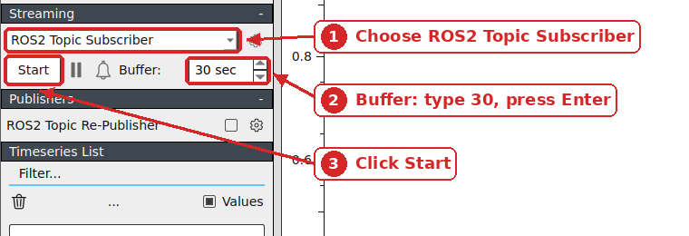
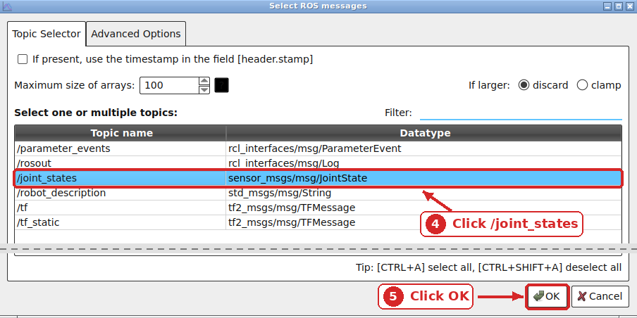
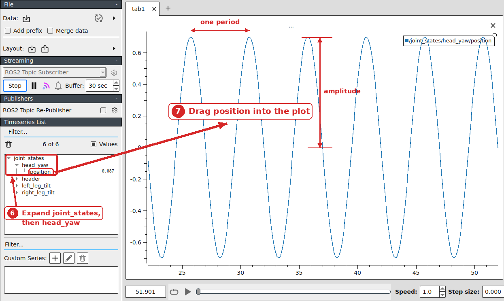

# HW01: ROS 2 setup and a joint-state publisher

The written assignment PDF supplied by the instructor defines the
deliverables. This page has the commands. A **host terminal** is a VS Code
terminal on your computer, in the course folder; a **container shell** is
opened from a host terminal with `docker compose exec course bash`
([two places to run commands](../../docs/setup.md#two-places-to-run-commands)).

## 1. Complete the setup guide

Work through **all** of [the setup guide](../../docs/setup.md), including the
Python parts used in later homework. Save the evidence the handout asks for
as you go:

- RViz showing the robot with its head turned, with the slider window visible;
- the output of `ros2 topic list` before and after starting the robot demo;
- the viewer-check window from your own computer's Python;
- the green "OpenCV test" window on the browser desktop;
- the line ending in `OK` from the learning-package check;
- your Docker version and image architecture, from a host terminal:

  ```text
  docker version
  docker image inspect intro-robotics-course:jazzy --format '{{.Os}}/{{.Architecture}}'
  ```

## 2. Run your publisher instead of the sliders

Start the container and open the browser desktop if they are not already
running ([quick start](../../docs/quick_start.md)). You need two container
shells, each in its own VS Code terminal.

**Container shell 1:** start RViz and `robot_state_publisher`, without the
slider window:

```bash
ros2 launch r2d2_demo view_r2d2.launch.py use_joint_gui:=false
```

`use_joint_gui:=false` is a *launch argument*: an option the launch file
reads. Here it skips the slider window, so your node will be the only
publisher of joint positions. RViz may show the robot's parts missing or a
"No transform" warning until your node publishes its first message; that does
not mean the installation failed. Leave this running.

**Container shell 2:** run your node:

```bash
cd /workspace
python3 homework/hw01/joint_publisher.py
```

Your starter raises a labeled `NotImplementedError` until you complete its
two methods. Edit the file in VS Code; the course folder is mounted at
`/workspace`, so you are editing the same file. Stop your node with Ctrl+C
and run it again after each edit. This is a plain Python script, so it needs
no `colcon build`.

The supplied class creates a publisher and a timer. `rclpy.spin(node)` lets
ROS call the timer callback every 0.1 seconds. First publish a fixed pose;
then compute changing positions from elapsed time. Repeating the same pose
holds the same picture. Changing the positions over time produces motion.
Use radians and stay within the supplied joint limits. A function named
`check_joint_positions` explains and checks those limits in `support.py`.

`/joint_states` reports the model's joint positions. `robot_state_publisher`
uses those states and the URDF to generate `/tf`; RViz displays the result.
This exercise animates a kinematic model; no motor controller is involved.

## 3. Check that the fixed pose holds

With your fixed-pose node running, RViz should show the robot holding your
chosen pose. Check the messages too: open a **third** VS Code terminal and a
third container shell, and run these one at a time:

```bash
ros2 topic echo /joint_states --once
ros2 topic echo /joint_states --once
ros2 topic echo /joint_states --field position
ros2 topic hz /joint_states
ros2 topic info /joint_states --verbose
```

Running `--once` twice gives two messages a moment apart; compare which
fields changed. `--field position` prints only the positions, about ten per
second; stop it, and the rate display, with Ctrl+C. Approximately 10 Hz is
expected; browser rendering and host load can affect what you observe. Check
that your node is the **only publisher** on `/joint_states`. RViz and
robot-state-publisher are subscribers. If the robot jumps between poses, a
second publisher is running (for example a slider window from an earlier
launch). Keep this third shell open.

## 4. Make it move, then check again

Change `joint_positions(elapsed)` so the head moves smoothly back and forth,
then stop and rerun your node. In the third shell, run the same five
commands again and compare with the fixed pose: what changed in the
messages, and did the rate change?

Make a 10–20 second screen recording of RViz while the head moves:

- **Windows 11:** open **Snipping Tool**, click its video-camera (Record)
  button, then **New**; drag a rectangle around RViz and click **Start**.
  Click the red stop button when done and save the video.
- **macOS:** press Cmd+Shift+5, choose **Record Selected Portion**, drag
  around RViz, and click **Record**. Click the stop button in the menu bar
  when done; the video is saved to your Desktop.

## 5. Plot the motion with PlotJuggler

With your moving node still running, stop any command in the third shell
with Ctrl+C and run:

```bash
ros2 run plotjuggler plotjuggler
```

A splash screen appears, then the PlotJuggler window opens on the browser
desktop. If its bottom is cut off, double-click the title bar to maximize it.
Close any "New release available" notice; do not update. A "Telemetry reply
error" line in the terminal is expected: the course container blocks
PlotJuggler's usage report.

**Steps 1–3:** in the **Streaming** panel, choose **ROS2 Topic Subscriber**,
set **Buffer** to 30 (type 30, press Enter) so the plot keeps at least two
periods, and click **Start**.



**Steps 4–5:** in the window that opens, click `/joint_states` and click
**OK**. If `/joint_states` is missing, your node is not running.



**Steps 6–7:** in the **Timeseries List**, expand `joint_states`, then
`head_yaw`, and drag `position` into the plot area.



The example above is not your answer; your curve has the period and
amplitude you chose. Click the pause button (two bars, next to **Stop**) to
freeze the plot, read the period (peak to peak) and amplitude (zero to
peak), and compare them with your `joint_positions` function.

Finally, explain how names correspond to positions, what the timestamp
means, and why a timer is used. The provided scaffold handles setup and
shutdown so the student work stays focused on message contents and motion
over time.

## 6. Finish and stop

Press Ctrl+C in each container shell to stop PlotJuggler, your node, and the
launch, then type `exit` in each to return to a host terminal. Run:

```text
docker compose down
```

You may then close the browser tab and quit Docker Desktop. Your source files
remain in the course folder. To see the slider demo again later, start the
container and run `ros2 launch r2d2_demo view_r2d2.launch.py` (without the
launch argument).

Submit your code, setup evidence, message/rate evidence, a short explanation,
and your AI-use statement as described in the handout.

## References

- [ROS 2 Python publisher tutorial](https://docs.ros.org/en/jazzy/Tutorials/Beginner-Client-Libraries/Writing-A-Simple-Py-Publisher-And-Subscriber.html)
- [JointState message fields](https://docs.ros.org/en/jazzy/p/sensor_msgs/msg/JointState.html)
- [Troubleshooting](../../docs/troubleshooting.md)
